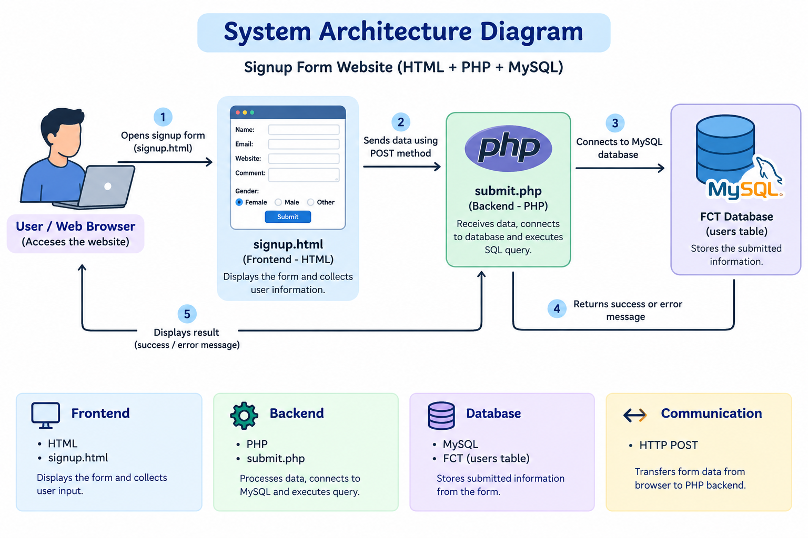
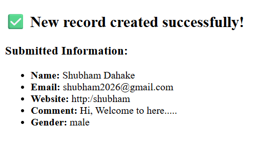

# Signup Form Website

## 1. Introduction

The **Signup Form Website** is a simple web application developed using HTML and PHP, with MySQL as the database. It allows users to submit their personal information through a signup form.

The form collects the user's name, email address, website URL, comment, and gender. When the user clicks the Submit button, the information is sent to the PHP backend and stored in the MySQL database.

### Objectives
- Create a user-friendly signup form.
- Collect user information through HTML input fields.
- Process form data using PHP.
- Store submitted information in a MySQL database.
- Display a submission success or error message.

## 2. Architectural Diagram

The following diagram illustrates how the website works:

### Architecture Components

- **Frontend – HTML:** Displays the signup form and collects user information.
- **Backend – PHP:** Receives the submitted data, connects to MySQL, and executes the database query.
- **Database – MySQL:** Stores the submitted information in the `users` table.
- **Communication – HTTP POST:** Transfers the form data from the browser to the PHP backend.

## 3. Input

The signup form collects the following information from the user.

| Field | Description | Input Type |
|---|---|---|
| Name | User's full name | Text |
| Email | User's email address | Email |
| Website | User's website URL | URL |
| Comment | Additional information | Textarea |
| Gender | User's selected gender | Radio Button |

### Input Process

1. The user opens `signup.html` in a web browser.
2. The user enters their name and email address.
3. The user optionally enters a website URL and comment.
4. The user selects their gender.
5. The user clicks the **Submit** button.
6. The form sends the information to `submit.php` using the HTTP POST method.

### Input Validation

- Name and email are required fields.
- Gender selection is required.
- The email field checks for a valid email format in the browser.
- The website field checks for a valid URL format when a value is entered.

**Note:** These validations are performed by the browser. Server-side validation should also be implemented in PHP for better security.

## 4. Output

After the user submits the form, the PHP script processes the information and attempts to store it in the MySQL database.

### Successful Output

If the database query succeeds, the website displays:

- A success message: **New record created successfully!**
- The submitted name.
- The submitted email address.
- The submitted website URL.
- The submitted comment.
- The selected gender.
  

### Error Output

If the database connection or insertion fails, the application displays an error message.

The submitted information is displayed on the result page using PHP's `htmlspecialchars()` function to help prevent HTML injection when rendering these values.

## 5. Background – PM2

**PM2 (Process Manager 2)** is a process manager commonly used to run and manage Node.js applications in the background.

### Key Features of PM2

- Runs supported applications as background processes.
- Restarts applications when they crash.
- Helps manage application logs.
- Supports automatic application startup after a server restart when configured.
- Provides commands to monitor and manage application processes.

### PM2 and This Project

This project currently uses HTML, PHP, and MySQL. **PM2 is not required for the current implementation.** PHP applications are typically served through a web server such as Apache or Nginx with PHP support.

If PM2 is part of the deployment environment or learning requirements, its role should be documented separately according to the actual deployment setup. Do not describe PM2 as running this website unless it has genuinely been configured to do so.

## 6. Conclusion

The Signup Form Website demonstrates the basic working of a web application using HTML, PHP, and MySQL. It shows how users can enter information through a frontend form, send the data to a backend script, save it in a database, and receive a result message.

This project provides practical experience with HTML forms, HTTP POST requests, PHP scripting, MySQL database connectivity, and basic web application architecture.

### Technologies Used

- **Frontend:** HTML
- **Backend:** PHP
- **Database:** MySQL
- **Communication:** HTTP POST
- **Optional deployment web server:** Apache or Nginx

### Future Improvements

- Add server-side input validation.
- Use prepared SQL statements to prevent SQL injection.
- Store database credentials securely.
- Improve the form's design using CSS.
- Add user authentication and better error handling.
